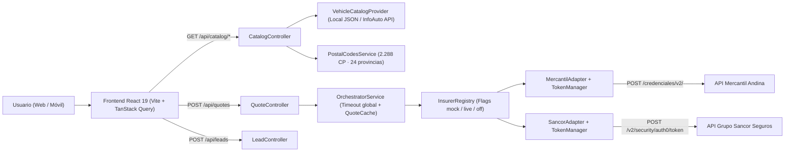

# Arquitectura — SegurosAutoYa (`multi/`)

Este documento describe la arquitectura técnica del multicotizador, el flujo completo de una cotización, los mecanismos de resiliencia y seguridad, y la estrategia de desacoplamiento de catálogos y aseguradoras.

---

## 1. Vista General del Sistema



---

## 2. Estructura de Directorios

```text
multi/
├── .github/workflows/ci.yml        # CI automático (backend + frontend en Node 22)
├── render.yaml                     # Blueprint de despliegue para Render
├── package.json                    # Scripts de conveniencia (--prefix)
├── DEPLOY_Y_APIS.md                # Guía operativa de deploy y activación live
├── docs/                           # Documentación técnica
│   ├── ARQUITECTURA.md
│   ├── API_REFERENCE.md
│   └── GUIA_NUEVA_ASEGURADORA.md
├── backend/
│   ├── Dockerfile                  # Imagen multi-stage Node 22 Alpine
│   ├── src/
│   │   ├── app.ts                  # Factory Express (middleware + rutas + errorHandler)
│   │   ├── index.ts                # Entrypoint HTTP + graceful shutdown (SIGINT/SIGTERM)
│   │   ├── config/
│   │   │   ├── env.ts              # Validación fail-fast con Zod según modos live/mock
│   │   │   └── insurers.ts         # Configuración comercial y de productor por compañía
│   │   ├── lib/
│   │   │   ├── logger.ts           # Logger JSON estructurado con redacción de secretos
│   │   │   ├── token-manager.ts    # Caché de tokens anti-stampede + refresh 401
│   │   │   └── quote-cache.ts      # Caché acotado en memoria (TTL configurable)
│   │   ├── catalog/
│   │   │   ├── data/               # vehicles-ar.json (204) + postal-codes-ar.json (2.413)
│   │   │   ├── local-catalog.provider.ts
│   │   │   ├── infoauto-api.provider.ts
│   │   │   ├── postal-codes.service.ts
│   │   │   └── import-infoauto.ts  # CLI para importar tablas CSV/JSON oficiales
│   │   ├── adapters/
│   │   │   ├── base.adapter.ts     # Cliente Axios con retries seguros para POST
│   │   │   ├── registry.ts         # Registro dinámico de compañías activas
│   │   │   ├── mercantil/          # Adapter + Mapper + Mock de Mercantil Andina
│   │   │   └── sancor/             # Types Swagger + Adapter + Mapper + Mock de Sancor
│   │   ├── services/orchestrator.service.ts
│   │   ├── controllers/            # quote, catalog, lead
│   │   ├── routes/                 # quote, catalog, lead
│   │   ├── schemas/                # Esquemas Zod de entrada
│   │   ├── middlewares/error-handler.ts
│   │   └── scripts/api-doctor.ts   # CLI de verificación end-to-end
│   └── tests/                      # 9 suites Vitest (unitarias + integración HTTP)
└── frontend/
    ├── vercel.json                 # Rewrites SPA + headers de seguridad
    └── src/
        ├── App.tsx                 # Layout, filtros multicompañía, ordenamiento y estados
        ├── services/api.ts         # Cliente Axios (timeout 15s + extracción real de errores)
        └── components/
            ├── quoteform.tsx       # Buscador rápido, catálogo encadenado y CP/Localidad AR
            └── quotecard.tsx       # Tarjeta de plan + suma asegurada + WhatsApp + tracking
```

---

## 3. Decisiones Técnicas Clave

### A. Resiliencia en la Orquestación
- **Aislamiento por proveedor:** `OrchestratorService` ejecuta todos los adaptadores habilitados en paralelo capturando errores individualmente. Si una aseguradora cae o supera el tiempo máximo, el usuario igual recibe los planes del resto junto con el aviso en `failedProviders` y el detalle de tiempos en `providerStatuses`.
- **Presupuesto global de tiempo (`QUOTE_TIMEOUT_MS`):** un `AbortController` aborta cualquier petición externa colgada para garantizar respuestas predecibles (~9s máx.).
- **Reintentos seguros en `BaseAdapter`:** las cotizaciones son consultas de lectura modeladas como `POST`. `axios-retry` está configurado para reintentar 1 vez únicamente ante cortes de red, timeouts o HTTP `429`/`5xx`, y **nunca** ante `4xx` ni cancelaciones por `AbortSignal`.
- **Caché de cotizaciones (`QuoteCache`):** TTL en memoria (default 5 min, máx. 500 claves) para evitar duplicar llamadas a aseguradoras cuando el usuario reenvía los mismos datos. Solo se cachean respuestas completas sin proveedores fallidos.

### B. Autenticación Segura (`TokenManager`)
- **Anti-*token stampede*:** cuando expira un token y llegan múltiples cotizaciones simultáneas, todas esperan la misma promesa en vuelo (`inFlight`), disparando un único login contra la aseguradora.
- **Renovación anticipada y ante `401`:** renueva 60s antes de `expires_in` y, si una API revoca el token anticipadamente devolviendo `401`, el adaptador invalida la caché y reintenta una única vez.

### C. Seguridad y Observabilidad
- **Validación *fail-fast* de `.env`:** activar `MERCANTIL_MODE=live`, `SANCOR_MODE=live` o `CATALOG_PROVIDER=infoauto-api` sin sus credenciales impide iniciar el servidor con un mensaje explícito.
- **Redacción de secretos en logs (`logger.ts`):** `sanitizeError` y `redactObject` eliminan `Authorization`, `password`, `Ocp-Apim-Subscription-Key`, `gss_apiclient_id` y tokens antes de serializar JSON a `stdout`/`stderr`.
- **Hardening HTTP:** `helmet`, `cors` con lista de orígenes permitidos, límite de payload JSON (`16kb`), error handler JSON global y rate limits separados (`300 req/15m` general y `60 req/15m` en `/api/quotes`).

### D. Estrategia de Catálogos (Vehículos + Códigos Postales)
- **Desacoplamiento por interfaz (`VehicleCatalogProvider`):** permite operar hoy con el catálogo argentino semilla (`vehicles-ar.json`, 26 marcas / 204 versiones con `codeOrigin: "seed"`), migrar sin tocar código a una tabla CSV/JSON oficial de InfoAuto (`npm run catalog:import` -> `backend/data/vehicles.infoauto.json`, `codeOrigin: "infoauto"`) o conectar directamente la API B2B de InfoAuto (`CATALOG_PROVIDER=infoauto-api`).
- **Padrón Argentino de Códigos Postales (`PostalCodesService`):** 2.288 códigos postales únicos en las 24 jurisdicciones indexados en memoria (<2 ms de arranque), soportando CP de 4 dígitos, formato CPA (`C1425ABC`) y búsqueda sin tildes por localidad o provincia.
